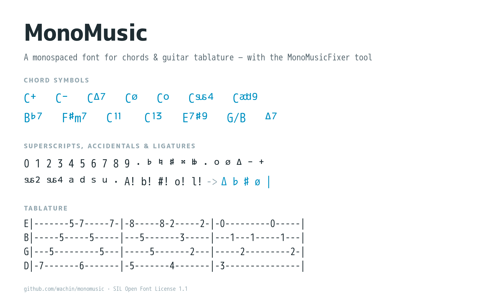

# MonoMusic

[](https://github.com/wachin/monomusic/blob/master/source/monomusic.sfdir/font.props)
[](#testing)
[](#download)
[](#download)
[](https://github.com/wachin/monomusic)

A monospaced font for **chords and guitar tablature**, plus a small browser tool — the
**MonoMusicFixer** — that turns the way you *type* chords into the way they should be
*printed*: proper superscripts, music accidentals and tab bars, all on a fixed pitch so
everything stays aligned.



## Why MonoMusic

- **Chords line up with the lyrics.** Every character has the same advance width, so
  a chord sits exactly above the syllable it belongs to — in a text editor, a forum
  post or a PDF.
- **Real chord notation, not approximations.** `Cmaj7` prints as `CΔ7`, `Cm7b5` as `Cø`,
  `Bb7` as `B♭7`, `C11` as `C¹¹` — using dedicated superscript glyphs, not small text.
- **Tablature that stays tablature.** Dashes, numbers and bar lines keep their columns,
  and `|` is turned into a proper tab bar glyph.
- **Ligatures built in:** `A!` `b!` `#!` `o!` `l!` become `Δ` `♭` `♯` `ø` `|`.

## Download

| File | Use it for |
|------|------------|
| [`MonoMusic-Regular.woff2`](MonoMusic-Regular.woff2) | the web (smallest) |
| [`MonoMusic-Regular.woff`](MonoMusic-Regular.woff) | older browsers |
| [`MonoMusic-Regular.ttf`](MonoMusic-Regular.ttf) | desktop apps, word processors, FontForge |
| [`resources/MonoManual.pdf`](resources/MonoManual.pdf) | the original 2015 manual |
| [`NOTATION.md`](NOTATION.md) | one-page chord & tab cheat sheet |

```css
@font-face {
  font-family: 'MonoMusic';
  src: url('MonoMusic-Regular.woff2') format('woff2'),
       url('MonoMusic-Regular.woff') format('woff'),
       url('MonoMusic-Regular.ttf') format('truetype');
  font-display: swap;
}
body { font-family: 'MonoMusic', monospace; font-feature-settings: "liga", "clig"; }
```

---

## Chord & tab symbols — a complete tutorial

New to reading charts? This section explains **every symbol MonoMusic can print**,
what it means on your instrument, and exactly what to type to get it. The one-page
version is in [NOTATION.md](NOTATION.md).

> **How to read the tables:** *Type* is what you write into the fixer; *Prints* shows
> the result, using Unicode superscripts (`⁷ ⁹ ♭ ⁺`) where your browser has them —
> MonoMusic prints all of them as real raised glyphs.

### 0. The shape of a chord name

Every chord symbol has up to four slots:

```
  root    quality   extension   bass note
   D        m7       add9        /F♯
```

1. **Root** — the letter(s): where the chord starts (`C`, `F♯`, `B♭`).
2. **Quality** — its character: major, minor, diminished, augmented, suspended.
3. **Extension / alteration** — extra notes stacked on top: `7`, `9`, `11`, `13`,
   `♯5`, `♭9`… Normally written *raised* (superscript) — that is exactly what
   MonoMusic does with them.
4. **Bass note** — after a `/`: the lowest note to play, when it is not the root.

### 1. Roots and accidentals

| Type | Prints | Name | What it does |
|------|--------|------|--------------|
| `#` or `♯` | `♯` | sharp | raises the root one semitone: `F♯` |
| `b` or `♭` | `♭` | flat | lowers the root one semitone: `B♭` |
| `♮` | `♮` | natural | cancels a previous ♯/♭ inside a bar (rare in charts) |
| `𝄪` (type `##!`) | `𝄪` | double sharp | raises two semitones — theory/charts only |
| `♭♭` (type `bb!`) | `𝄫` | double flat | lowers two semitones — theory/charts only |

- Every sharp is also a flat one octave class: `C♯` = `D♭` (enharmonics). Which spelling
  you use depends on the key: in B♭ you write `B♭`, in F♯ you write `F♯`.
- **`H` = `B`.** Danish, Norwegian, German and Polish charts write `H` for B, and `B`
  for B♭. The fixer has a **B→H** button if your band reads that way.

### 2. Quality — what the suffix means

| Type | Prints | Name | What it sounds like / when you see it |
|------|--------|------|----------------------------------------|
| `C` | `C` | major | the default; bright and stable |
| `Cm`, `C-` | `Cm`, `C⁻` | minor | darker — flat third; the "sad" version of C |
| `Cdim`, `C°`, `Co` | `Cᵒ` | diminished | tense, unstable (♭3 and ♭5); classic passing chord |
| `C+`, `Caug` | `C⁺` | augmented | dreamy / suspenseful — raised fifth; needs to resolve |
| `Csus2` | `C` + raised `sus2` | suspended 2nd | open, neither major nor minor; the 2nd replaces the 3rd |
| `Csus4` | `C` + raised `sus4` | suspended 4th | the classic "sus" in worship pads and intros; resolves down to the 3rd |
| `C5` | `C⁵` | power chord | root + fifth only — the distorted guitar workhorse |

> **Minor:** both `Cm` and `C-` mean minor. `m` prints as a normal letter, `-` prints
> as a raised minus (`C⁻`). Use whichever your chart uses.

### 3. The sevenths — the ones you meet in every worship chart

| Type | Reads as | What it is |
|------|----------|------------|
| `C7` | C **dominant** 7 | major triad + minor 7th; wants to resolve to F. The engine of V→I motion |
| `Cmaj7`, `CM7` | C **major** 7 | major triad + major 7th → soft, warm, hymn-like colour |
| `Cm7`, `Cmin7` | C minor 7 | minor triad + minor 7th → the gentle pop/worship minor |
| `Cø`, `Cm7b5` | C **half-diminished** | the same chord under two names; looks like a slashed circle `ø`. Pre-dominant in minor keys: `Bø → E7 → Am` |
| `Cdim7`, `C°7` | C **diminished** 7 | fully diminished; tense passing chord that slides anywhere |
| `CmM7`, `CmΔ7` | C **minor–major** 7 | minor triad with a major 7th; moody, cinematic |
| `CΔ` | C major (7 implied) | some charts write `Δ` alone for a major-7 colour |

> **Memory trick:** `ø` is `°` with a line through it → *half* a diminished chord.
> `°` = fully diminished, `ø` = half-diminished (= `m7♭5`, minor 7 flat 5).

### 4. Numbers: 5, 6, 9, 11, 13 — and why they are raised

Stack thirds on top of a triad and you get the ladder:

```
triad      1 3 5
7th chord  1 3 5 7
9th        1 3 5 7 9      ← written C9
11th       1 3 5 7 9 11   ← written C11
13th       1 3 5 7 9 11 13 ← written C13
```

Charts only use **odd** numbers past 7, because the even ones are just the chord
tones renamed (9 = 2 up an octave, 11 = 4, 13 = 6).

| Type | Prints | Meaning |
|------|--------|---------|
| `C5` | `C⁵` | power chord (root + 5th) |
| `C6` | `C⁶` | major triad + 6th — sweet, retro |
| `C9` | `C⁹` | dominant 7 + 9 — funky, jazzy |
| `C11` | `C¹¹` | dominant 7 + 9 + 11 (MonoMusic ligates the `11` into one raised glyph) |
| `C13` | `C¹³` | dominant 7 + 9 + 11 + 13 — lush, one-hand-friendly |
| `C69` / `C6/9` | `C⁶⁹` / `C⁶⁄⁹` | 6 and 9 together — bright and open |

### 5. `add` vs plain extensions — and `sus`

| Type | Prints | Difference |
|------|--------|------------|
| `Cadd9` | `C` + raised `add9` | triad **plus** a 9th, nothing else — the open, ringing chord in countless worship songs |
| `C9` | `C⁹` | triad **plus a 7th** plus 9th — busier, jazzy |
| `Cadd2`, `Cadd6`, `Cadd11`, `Cadd13` | raised `add…` | same idea: add the tone, keep the rest simple |
| `Csus2` / `Csus4` | raised `sus2` / `sus4` | *replace* the 3rd → the chord has no major/minor colour until it resolves |

Rule of thumb: **`add` keeps the triad and adds; `sus` swaps the third; a bare number
brings the whole stack (7th included).**

### 6. Altered dominants — the "fancy" sevenths

You will meet these in bridges and turnarounds:

| Type | Prints | What it is |
|------|--------|------------|
| `C7sus4` | `C⁷sus⁴` | dominant with a suspended 4th — the floaty, unresolved 7 (very common in pads) |
| `C7#5` | `C⁷♯⁵` | augmented dominant — stretched, pointing hard at the target |
| `C7b9` | `C⁷♭⁹` | dominant with a flat 9 — dramatic pull (tango/altar-call tension) |
| `C7#9` | `C⁷♯⁹` | the "Hendrix chord" — blues-rock edge over a dominant |
| `C7#11`, `C7#4` | `C⁷♯¹¹`, `C⁷♯⁴` | lydian-dominant colour — dreamy dominant |
| `Cb9sus` | `C♭⁹sus` | ♭9 + sus4 — a dominant that refuses to settle |

### 7. Slash chords — the note after the `/`

```
D/F♯   →  play a D chord, but F♯ in the bass
C/E    →  C chord with E in the bass
Bb7/D  →  B♭7 with D in the bass
```

- **The letter after `/` is the bass note**, not a new chord.
- This is how writers make the bass line move stepwise: `C → C/E → F` walks
  `C–E–F` underneath.
- In a band: the **bass player plays the slash note**; the guitarist can strum the
  chord normally. With a capo, the chart stays in the written key and the slash still
  means "bass note", so `D/F♯` with capo 2 is really `E/G♯` sounding.
- MonoMusic prints slash chords untouched (`G/B`, `C/E`) so the `/` stays aligned.

### 8. Symbol dictionary — every sign, at a glance

| Symbol | Name | Meaning | How to type it |
|--------|------|---------|----------------|
| `m` | minor | minor triad | `m` |
| `−` | minus | same as minor | `-` |
| `°` `o` `dim` | diminished | ♭3 + ♭5 | `C°`, `Co`, `Cdim` |
| `ø` | half-diminished | = `m7♭5` | `Cø`, `Cm7b5` |
| `+` `aug` | augmented | raised 5th | `C+`, `Caug` |
| `Δ` `maj7` `M7` | major 7th | major triad + major 7 | `Cmaj7`, `CM7`, `A!` |
| `♯` | sharp | +1 semitone | `#` |
| `♭` | flat | −1 semitone | `b` |
| `♮` | natural | cancels ♯/♭ | `♮` |
| `𝄪` | double sharp | +2 semitones | `##!` |
| `𝄫` | double flat | −2 semitones | `bb!` |
| `sus2` `sus4` | suspended | 3rd replaced by 2nd/4th | `Csus2`, `Csus4` |
| `add9` … | added tone | triad + that tone | `Cadd9`, `Cadd11`, `Cadd13` |
| `5 6 9 11 13` | extensions | stacked thirds (raised) | `C5`, `C6`, `C9`, `C11`, `C13` |
| `/` | slash chord | note after `/` = bass | `D/F♯` |
| `H` | Nordic B | `H`=B, `B`=B♭ | `H7`, or press **B→H** |
| `x` | mute (tab) | string not played | `x` |
| `│` | tab bar | bar line | `l!`, or `|` through the fixer |

### 9. Tablature symbols

```
E|-------5-7-----7-|-8-----8-2-----2-|
B|-----5-----5-----|---5-------3-----|
```

| Symbol | Meaning |
|--------|---------|
| `E A D G B e` | the six strings, thickest (bottom line) to thinnest (top line) |
| `5` `7` `0` | fret to press; `0` = open string |
| `-` | empty beat — let it ring or count the rhythm |
| `\|` | bar line (the fixer converts it to the font's tab-bar glyph) |
| `x` | mute / don't play that string |
| `/8` | slide into the 8th fret (as in the original `0--/8-7` example) |

Everything is monospaced, so columns never shift — copy a tab into any editor,
forum or chat and it still lines up.

### 10. Two-character shortcuts (ligatures)

With MonoMusic active, these print as a single music symbol **without** the fixer:

| Type | Prints |
|------|--------|
| `A!` | `Δ` (major 7th) |
| `b!` | `♭` |
| `#!` | `♯` |
| `o!` | `ø` |
| `bb!` | `𝄫` |
| `##!` | `𝄪` |
| `l!` | `│` tab bar |

> Ligatures are standard OpenType `liga` features: on by default in browsers and most
> desktop apps. If nothing happens, enable `font-feature-settings: "liga"`.
> Inside the fixer, `A!` is also converted for you (it is how you type `Δ` quickly).

### 11. Putting it together — a chart, start to finish

What you type:

```
Wonderwall (Capo II)                    you type          it prints
Em7        G          Dsus2   A7sus4    Cmaj7  Cø  C7#9
Today is gonna be the day…              Cmaj7  →          CΔ7 (raised)
E|-------5-7-----7-|-8-----8-2-----2-|   E|               E│ (bar glyph)
```

1. Type the chords above the lyrics, one chord per syllable change.
2. Paste the tab below with `|` bars and `-` beats.
3. Press **Fix** — everything above is converted: extensions raise, `b`/`#` become
  `♭`/`♯`, `m7b5` becomes `ø`, tabs keep their columns.
4. Copy the result into your lyrics sheet / planning app / printout.

If a chord does not convert (say `Calt7` or `Cmaj` on their own), use one of the
spellings listed in this tutorial — those are the forms the fixer recognises.

---

## The MonoMusicFixer

The fixer is a plain static page — no build step, no server-side code:

```bash
python3 -m http.server 8123
# open http://localhost:8123/index.html
```

Paste your chords and tab, press **Fix**, copy the result.

| Button | What it does |
|--------|--------------|
| **Fix** | converts the text (also on <kbd>Enter</kbd>) |
| **Title** | show / hide the document title |
| **Adsu** | adds the missing space(s) after `add` and `sus` chords |
| **B→H** | converts `B` to `H` for Danish/Norwegian notation |
| **+ / −** | font size |
| **Done** | hide everything but the document (press <kbd>Esc</kbd> to come back) |

Full one-page notation reference: **[NOTATION.md](NOTATION.md)**.

## Testing

```bash
npm install   # once (installs jsdom)
npm test      # node --test + font contract
```

- **13 fixer tests** (`test/fixer.test.js`) load the real `index.html` in jsdom, press
  *Fix* and assert the exact private-use code points of the output.
- **Font contract test** (`test/font_contract.py`, needs `fontTools`) asserts that the
  FontForge source (`.sfdir`), the three shipped binaries and the fixer agree: same
  `cmap`, same glyph names, same ligature set, every `U+E0xx` the fixer emits maps to
  the right superscript glyph, and every character of the manual is covered.

Both must pass after any change to the font or to `js/chordhighlight.js`.

## Building the font

The source is a FontForge directory: [`source/monomusic.sfdir/`](source/monomusic.sfdir)
(`SplineFontDB: 3.0`). To re-export:

```bash
fontforge -lang=ff -c 'Open($1); Generate($2); Close();' \
  source/monomusic.sfdir MonoMusic-Regular.ttf

python3 -c "from fontTools.ttLib import TTFont; \
f=TTFont('MonoMusic-Regular.ttf'); f.flavor='woff';  f.save('MonoMusic-Regular.woff'); \
f=TTFont('MonoMusic-Regular.ttf'); f.flavor='woff2'; f.save('MonoMusic-Regular.woff2')"
```

Then run `npm test` — the contract test is what keeps source, binaries and fixer in step.

## Credits & license

- Original design and tool: [@andreaslarsendk](https://github.com/andreaslarsen) (2015),
  based on outlines from the **M+ FONTS PROJECT** (`Copyright(c) 2008 M+ FONTS PROJECT`,
  `Copyright(c) 2015 @andreaslarsendk`).
- Licensed under the **[SIL Open Font License 1.1](source/monomusic.sfdir/font.props)** —
  you may use, study, modify and redistribute it; the font names are reserved, so
  modified versions may not use the reserved names.
- Third-party code in `js/`: [jQuery.highlight](https://github.com/bartaz/jquery.highlight)
  (Johann Burkard / Bartek Szopka), jQuery, Foundation 5, PrefixFree (Lea Verou),
  jquery-simplecolorpicker — untouched upstream libraries.
